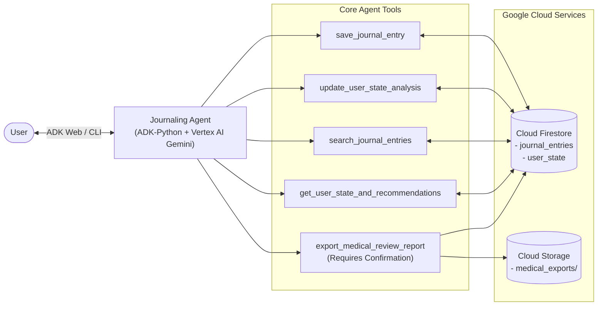

# Baseline System Design — Daily Journaling Agent

> [!IMPORTANT]
> **Simplicity & Iteration Philosophy:** This design is intentionally minimal and independent of the full evaluation rubric. It is built to **showcase core capabilities of an AI agentic system** and is **not designed to support large-scale production workloads**. We start with a single `ADK-Python` agent, a flat Cloud Firestore data model, and five focused tools so the core journaling workflow operates end-to-end immediately. Additional architectural layers can be added incrementally as we iterate.

---

## 1. Design Risks & Blind Spots Addressed

1. **Clinical Overreach vs. Observational Reporting:** Exporting an analysis for a medical professional carries the risk of the LLM fabricating clinical diagnoses. Both the state analysis updater and the medical export tool must restrict outputs to **self-reported observations, emotional trends, and verbatim quotes** tied to entry dates—explicitly excluding diagnostic labels or medical advice.
2. **Unbounded State Recomputation:** Re-analyzing all historical entries on every turn causes context bloat and latency growth over time. State synthesis is bounded to a **rolling window of recent entries** (e.g., the last 7–14 entries).
3. **Cloud Storage Complexity:** Provisioning dedicated vector infrastructure (such as Vertex AI Vector Search index endpoints) introduces long deployment times and operational overhead unnecessary for an initial baseline. Starting with **Google Cloud Firestore** keeps the system 100% Google Cloud-native while supporting immediate document persistence and date-range retrieval.

---

## 2. High-Level Architecture (Iteration 1 Baseline)

---

## 3. Cloud Data Model (Cloud Firestore)

All persistent state lives in two Firestore collections keyed by `user_id`:

* **`users/{user_id}/journal_entries/{entry_id}`** (Immutable verbatim record)
  * `created_at`: ISO-8601 timestamp
  * `raw_text`: Exact, unmodified text submitted by the user
  * `tags`: Optional list of topics/emotions extracted at write time
* **`users/{user_id}/state_summaries/latest`** (Rolling user state analysis)
  * `updated_at`: ISO-8601 timestamp
  * `entry_window_count`: Number of recent entries analyzed (e.g., last 10)
  * `emotional_states`: Summary of prevailing moods, shifts, and triggers
  * `personal_challenges`: Recurring stressors, obstacles, or unresolved themes
  * `personal_growth`: Positive habits, milestones, and coping progress
  * `observed_patterns`: Cross-entry behavioral or emotional correlations
  * `recommendations`: 2–3 concrete, non-clinical suggestions grounded in the observed patterns

---

## 4. Agent & Tool Design (`ADK-Python`)

In Iteration 1, a single `LlmAgent` powered by Gemini on Vertex AI orchestrates five tools:

| Tool Name | Purpose | Key Behavior |
| :--- | :--- | :--- |
| `save_journal_entry` | Stores the user's exact daily journal entry. | Writes `raw_text` and timestamp directly to Firestore without altering the user's words. |
| `update_user_state_analysis` | Refreshes the user state analysis after a new entry is saved. | Fetches the last $N$ entries from Firestore, synthesizes updates for **personal challenges, growth, emotional states, and patterns**, and writes the updated snapshot to `state_summaries/latest`. |
| `search_journal_entries` | Retrieves past entries to answer questions about the user. | Queries Firestore by date range or keyword match so the agent can answer questions with exact dates and quotes. |
| `get_user_state_and_recommendations` | Reads the current state analysis and generates recommendations. | Pulls `state_summaries/latest` and returns pattern-backed lifestyle/journaling recommendations. |
| `export_medical_review_report` | **High-stakes action:** Exports a structured summary for a medical professional. | Compiles recent emotional states, challenges, growth, and dated entry excerpts into a structured Markdown/JSON report and uploads it to a **Cloud Storage** bucket (returning a URI). Guarded by an explicit user confirmation step before execution. |

---

## 5. Core User Flows

1. **Logging a Daily Entry:**
   * The user shares their daily reflection.
   * The agent calls `save_journal_entry` to persist the verbatim text, then calls `update_user_state_analysis` to update the rolling synthesis of emotional state, challenges, and growth.
2. **Asking Questions & Getting Recommendations:**
   * When the user asks questions about their history or seeks advice, the agent calls `search_journal_entries` and `get_user_state_and_recommendations` to ground its response in stored entries and observed patterns.
3. **Exporting for a Medical Professional (High-Stakes Action):**
   * When the user requests an export for their doctor or therapist, the agent first presents a preview of what will be included (date range, summarized emotional states, challenges, and growth) and asks for explicit confirmation before executing `export_medical_review_report`.

---

## 6. Iterative Roadmap

Starting from this small foundation allows us to layer in additional features step by step:
* **Iteration 1 (Baseline):** Single ADK agent, Firestore storage for raw entries + state analysis, Q&A retrieval, pattern recommendations, and GCS medical report export.
* **Iteration 2 (Orchestration & HITL):** Split the single agent into a Coordinator + specialized Sub-agents (e.g., *Entry Recorder*, *State Analyst*, *Medical Export Specialist*) and enforce ADK Human-in-the-Loop confirmation callbacks on the export tool.
* **Iteration 3 (Safety, Observability & Ops):** Add Cloud DLP / PII redaction, OpenTelemetry tracing, structured JSON logging, Secret Manager integration, Terraform provisioning, and an ADK evaluation suite.
