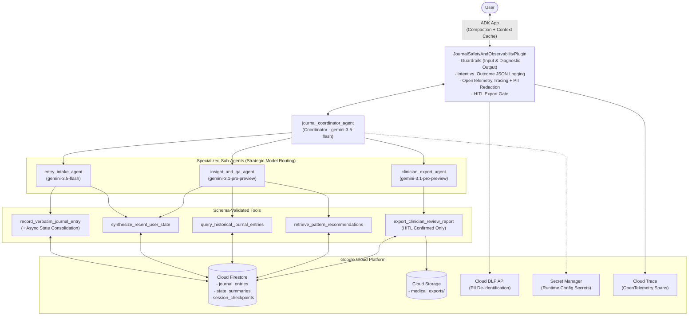

# Iteration 2 System Design — Full Rubric-Aligned Daily Journaling Agent

> [!IMPORTANT]
> **Scope & Intent:** Like Iteration 1, this system is a **simple demonstration system** built to showcase core capabilities of an AI agentic system and satisfy the 95-point **AgentOps Code Review Matrix**. It is **not** designed to support large-scale production workloads.

---

## 1. Design Critiques & Trade-Offs Addressed in Iteration 2

1. **Multi-Agent Overhead vs. Clear Responsibility Boundaries:** Splitting a small system into too many sub-agents increases latency and token usage via extra handoffs. To keep latency low while demonstrating ADK multi-agent orchestration and strategic model routing, Iteration 2 uses a **3-specialist Coordinator hierarchy**:
   * **Fast Tier (`gemini-3.5-flash`):** `entry_intake_agent` handles low-latency verbatim journal recording and triggers non-blocking background state synthesis.
   * **Reasoning Tier (`gemini-3.1-pro-preview`):** `insight_and_qa_agent` (longitudinal Q&A and pattern recommendations) and `clinician_export_agent` (high-stakes medical report preview and confirmed export).
2. **PII Scrubbing Latency in Logging Pipelines:** Calling the remote Cloud DLP API synchronously on every log line would stall request execution. The PII redaction pipeline (`journal_agent/observability.py`) runs deterministic local regex scrubbing (`EMAIL`, `PHONE`, `SSN`) on every structured log and memory write, and supports on-demand **Google Cloud DLP (`google-cloud-dlp`)** inspection/de-identification for persisted exports and state synthesis.
3. **Human-in-the-Loop (HITL) Bypass Risk:** Relying solely on system prompt instructions to prevent unconfirmed medical exports is fragile if the LLM hallucinates `user_confirmed=True`. Iteration 2 enforces HITL in **both** the ADK `before_tool_callback` plugin hook (verifying that a preview was generated in session state before allowing `user_confirmed=True`) and inside the tool implementation itself.

---

## 2. Iteration 2 Architecture

---

## 3. Mapping to the 95-Point AgentOps Code Review Matrix

| Category | Criterion (5 pts each) | Iteration 2 Implementation (`journal_agent/`) |
| :--- | :--- | :--- |
| **1. Tool & Interface Design** | **Comprehensive Tool Docstrings** | Detailed Google-style docstrings on all tools in `tools.py` covering purpose, args, return dicts, and error recovery. |
| | **Descriptive Naming** | Action-specific tool names: `record_verbatim_journal_entry`, `synthesize_recent_user_state`, `query_historical_journal_entries`, `retrieve_pattern_recommendations`, `export_clinician_review_report`. |
| | **Explicit JSON Schemas** | Frozen Pydantic v2 models in `models.py` (`JournalEntryInput`, `JournalEntryRecord`, `UserStateSynthesis`, `UserStateSummary`, `MedicalReviewReport`) validating inputs and constraining Gemini JSON outputs. |
| | **Guided Error Handling** | Every tool and `on_tool_error_callback` returns structured recovery instructions (`recovery_instruction`) back to the LLM instead of raising unhandled exceptions. |
| **2. Context & Memory** | **Robust System Instructions** | Explicit constitution in `agent.py` defining persona, observational non-clinical boundaries, privacy rules, and tool workflows. |
| | **History Compaction** | `EventsCompactionConfig` and `ContextCacheConfig` wired into the ADK `App` in `agent.py`, plus sliding-window message compaction in `memory.py`. |
| | **Persistent Session State** | Cloud Firestore persistence in `storage.py` for verbatim entries, rolling state summaries, and session state checkpoints. |
| | **Async Memory Operations** | `schedule_async_state_consolidation` in `memory.py` uses `asyncio.create_task` and `asyncio.to_thread` for non-blocking background memory synthesis. |
| **3. Orchestration & Logic** | **Multi-Agent Patterns** | Coordinator (`journal_coordinator_agent`) delegating to 3 specialized sub-agents (`entry_intake_agent`, `insight_and_qa_agent`, `clinician_export_agent`). |
| | **Strategic Model Routing** | `select_model_for_task` routes intake tasks to `gemini-3.5-flash` and complex longitudinal analysis/clinician exports to `gemini-3.1-pro-preview`. |
| | **Guardrails & Policy Plugins** | `JournalSafetyAndObservabilityPlugin` (`guardrails.py`) enforces input prompt-injection checks and output self-evaluation blocking prohibited diagnostic claims. |
| | **Human-in-the-Loop Hooks** | `before_tool_callback` in `guardrails.py` + `export_clinician_review_report` require a preview step in session state and explicit user approval before GCS upload. |
| **4. Observability & Tracing** | **Structured JSON Logging** | `StructuredJsonFormatter` in `observability.py` emits structured JSON logs with timestamp, severity, trace/span IDs, and event payloads. |
| | **Intent vs. Outcome Capture** | `before_tool_callback` logs `event_type="tool_intent"` before execution and `after_tool_callback` logs `event_type="tool_outcome"` afterward. |
| | **Distributed Tracing** | OpenTelemetry `TracerProvider` + `CloudTraceSpanExporter` in `observability.py` linking spans across agent, model, and tool execution. |
| | **PII Redaction** | `PiiRedactor` in `observability.py` combines deterministic regex scrubbing and Google Cloud DLP API (`google-cloud-dlp`) de-identification before logging or storage. |
| **5. Infrastructure & CI/CD** | **Automated Evaluation Suites** | Golden evaluation dataset (`evals/golden_dataset.json`) and automated regression harness (`tests/test_eval_suite.py`). |
| | **Infrastructure as Code** | Terraform configuration in `terraform/` (`main.tf`, `variables.tf`, `outputs.tf`) plus documented `adk` CLI commands in `README.md`. |
| | **Secure Secret Management** | `SecretManagerClient` in `secrets.py` retrieves secrets from Google Cloud Secret Manager (`google-cloud-secret-manager`) with zero hardcoded keys. |
